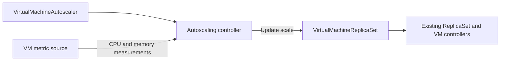

# Implementation plan for VM horizontal autoscaling

**Status**: Draft. **Epic**: TBD. Implements [spec.md](spec.md), with API details in [model.md](model.md) and dependencies in [tasks.md](tasks.md).

## Summary

Add one VirtualMachineAutoscaler resource and one controller that receives VM CPU/memory measurements, calculates desired replicas, and updates an existing ReplicaSet's scale subresource. Reuse VM lifecycle controllers. Keep collection/cache internal to the same operator and expose no secondary scaling-request API.

## Technical context

Baseline: commit d2e068ec0, branch features/hpa-for-vm-service. Root Go version is 1.26.9; API module intentionally remains Go 1.23.0. Root dependencies include controller-runtime v0.25.2, client-go v0.37.1, and govmomi v0.57.0-alpha.0.0.20260930024634-9b65cf3964d3. Preserve API module's older Kubernetes/controller-runtime dependency versions and do not upgrade them for this feature.

Affected modules: root, api, test/e2e if its module tooling applies. Use current repo tooling for API tests; there is no existing api/test/v1alpha6 directory to assume. No new external library or direct edits to external/ are planned.

Implementation baseline: new v1alpha6 CRD; direct vSphere performance metric provider; isolated autoscaler binary/deployment; existing manager hosts admission. These are planned implementation choices, distinct from the agreed one-resource contract. Q1–Q4 constrain semantic completion and production enablement.

## Constitution check

| Requirement | Planned treatment |
| --- | --- |
| SDD before implementation | This package plus API model/research; Epic and task tickets still TBD by author instruction |
| Thin controllers | Eligibility, calculation, history, and limits in pkg/autoscaling |
| Provider boundary | All performance API calls and counter discovery under pkg/providers/vsphere |
| API compatibility | New resource only; no shipped VM/ReplicaSet fields changed; future versions require conversion |
| Generated files | Generate deepcopy, CRDs, webhook and RBAC manifests; inspect generated diff |
| Feature gating | pkgcfg.FromContext(ctx) at registration and before collection/writes; depend on K8sWorkloadMgmtAPI |
| Reconcile pattern | pkgcfg.JoinContext first, typed context, named reterr, deferred patch helper, contextual errors |
| Status/conditions | observedGeneration and Ready; conditions describe state, not execution gates |
| VM order/ownership | No changes to 11-step VM reconciliation; autoscaler never creates/deletes individual VMs |
| Tests | Ginkgo external packages, one test file and suite per new package, labels and controlled clocks; E2E in same behavior PR |
| Source hygiene | Copyright/godoc, canonical aliases, masked wiki references; no vendored external edits |

No constitutional exception is requested. Ticket assignment is a merge prerequisite, not a fabricated compliance claim.

## Components and paths

| Component | Planned files |
| --- | --- |
| API | api/v1alpha6/virtualmachineautoscaler_types.go; generated deepcopy and config/crd/bases/vmoperator.vmware.com_virtualmachineautoscalers.yaml |
| Policy engine | pkg/autoscaling/eligibility.go, calculation.go, history.go, scale.go, autoscaling_test.go, autoscaling_suite_test.go |
| Measurement contract | pkg/providers/metrics_provider_interface.go; narrow interface separate from VMProvider lifecycle methods |
| vSphere provider | pkg/providers/vsphere/autoscaling/provider.go, counters.go, autoscaling_test.go, autoscaling_suite_test.go |
| Internal collector | services/vm-autoscaler-metrics/collector.go, collector_test.go, collector_suite_test.go |
| Controller/context | controllers/virtualmachineautoscaler/virtualmachineautoscaler_controller.go and corresponding test/suite; pkg/context/virtualmachineautoscaler_context.go |
| New-resource admission | webhooks/virtualmachineautoscaler/webhooks.go; validation/virtualmachineautoscaler_validator.go and test/suite |
| Scale protection | webhooks/virtualmachinereplicaset/scale/scale_validator.go and test/suite; existing ReplicaSet validation and registration |
| Manager/binary | cmd/vm-autoscaler/main.go; pkg/manager/autoscaler/setup.go and setup_test.go/setup_suite_test.go |
| Config/capability | pkg/config/config.go, default.go, capabilities/capabilities.go and existing tests |
| Packaging | config/autoscaler/{kustomization.yaml,manager.yaml,rbac.yaml,pdb.yaml}; config/wcp/vmoperator/kustomization.yaml; Dockerfile; Makefile |
| CRD/webhook lifecycle | pkg/crd/crd.go and crd_test.go; config/crd/kustomization.yaml; config/webhook/manifests.yaml; webhooks/webhooks.go |
| E2E/docs | test/e2e/vmservice/vmservice/virtualmachineautoscaler/autoscaler.go; lib/vmoperator/virtualmachineautoscaler.go; docs/concepts/workloads/autoscaling.md |

New paths are proposals to create, not claims that these packages exist. Keep tests for a new package in one _test.go file plus one suite. If an existing package layout differs, extend its established suite rather than refactoring unrelated tests.

## API, activation, and ownership

Implement model.md with CEL for local validation and Go admission for live target identity and SubjectAccessReview. Require UID in the immutable target reference; no lookup/rebind by name after recreation. Name equality provides single-policy uniqueness. Handle CREATE, UPDATE, DELETE, status, and scale admission independently.

Extend existing main-resource validation and add an admission endpoint for scale objects. Protect all served ReplicaSet versions so callers cannot bypass ownership through an older API. The Scale request's GVK does not identify its target resource; use AdmissionRequest resource/subresource/name/namespace and an uncached target read. Validate configured autoscaler service-account identity, not an arbitrary username suffix.

After any target resourceVersion conflict, recompute using current target and current policy. Check policy suspend/generation and leadership immediately before writes. Serialize scale activity per target; drain/cancel local in-flight work before acknowledging suspension. Previously accepted API/VM operations may complete. Verify cross-object activation/suspension races with real admission tests; if the mechanism cannot satisfy AC19/21/23, stop that task and revise the design rather than claiming list/read checks are transactional.

No target ownerReference from the autoscaler and no target deletion finalizer. Its only desired-state mutation is scale; status is patched separately. Normal deletion removes internal cached data and retains current target capacity.

## Provider and collector

Define a narrow MetricsProvider returning typed batches of samples with VM UID, provider identity, source timestamp, interval, metric name/value, and capacity/power epoch. Keep these types provider-neutral. Inject an authenticated vSphere client factory into pkg/providers/vsphere/autoscaling, reusing credential/session and certificate rotation patterns. Do not instantiate the complete VM lifecycle provider merely to get a metrics client.

All provider calls use pkgctx.WithVCOpID, deadlines, cancellation, and contextual errors. Discover counter IDs and available intervals; use VM aggregate CPU and Q1-approved memory counters. Normalize percent fixed-point values once. No CLI shelling to govc and no Prometheus dependency. No automatic provider switch on outage.

Collector is one leader-elected manager runnable with a bounded UID-keyed cache. Index watched VM ownership and target references. Poll only autoscaled targets, batch VMs/metrics, bound concurrency and vCenter QPS, back off with jitter, and enforce namespace fairness. Return incomplete/expired samples as invalid, never zero. Drop cached identities on deletion, power transition, or resize.

Provisional cadence/window/age: 30/60/90 seconds. Evaluate a common completed window ending at the newest common source time, no older than 90 seconds; require full interval coverage for every eligible member. Deduplicate overlapping intervals and do not count the same observation twice because reconciliation ran twice.

## Policy computation

1. Resolve current target/UID, owned VM membership, selector consistency, actual resolved capacity, readiness, power, and pending/terminating counts. ReplicaSet status.readyReplicas alone is insufficient.
2. Hold metric-based changes unless the set is converged and all members are eligible. Startup timeout is diagnostic; it does not delete VMs.
3. For each complete valid metric calculate ceil(N × mean/target). If abs(mean/target - 1) <= tolerance/100, retain N. Use overflow-safe arithmetic and clamp to supported int32 bounds.
4. Choose the maximum recommendation. Partial metric coverage invalidates that metric; any invalid configured metric blocks scale-in, while a valid metric may permit scale-out.
5. Clamp raw recommendation to min/max; apply direction permissions, scale-in stabilization, rate limits, and lifecycle protections. Never let later clamping bypass scale-in disabled or pending-operation checks. AC12 covers temporary bound violations.
6. Use a conservative rate limiter: at most one successful count change per direction's configured period, with the step capped by model.md. Do not reset that period on no-op reconciles or policy edits. Conservatively share the most recent scale timestamp across direction changes to prevent rapid reversal.
7. Write Scale with resourceVersion precondition only when count changes. Status reports raw, limited, and applied/observed counts distinctly.

Bound in-memory history by maximum 3600-second window and evaluation cadence, retaining timestamped recommendations. Only new source observation windows advance valid low-demand history. Missing/incomplete samples, membership changes, resume, and materially changed policy/capacity invalidate scale-in history; require a fresh full window. Never age away high recommendations through a telemetry outage and immediately downscale on the first recovered sample.

No time series goes into etcd. Persist last successful scale time/target for diagnostics. On startup/leader change, assume an unrecorded successful write may have occurred: hold new scaling for the maximum applicable scale period, collect fresh windows, and require complete scale-in history. Treat target desired count as authority even if autoscaler status is stale. On uncertain API outcome within a process, reread and enter the same conservative recovery state.

## Deployment, feature lifecycle, and upgrades

Propose a dedicated binary in the existing release image with explicit command /vm-autoscaler and its own leader Lease. Two pods, one active. Register only the autoscaler and collector, not controllers.AddToManager or services.AddToManager wholesale. Existing manager owns CRD installation and admission. Review pkg/manager initialization: its default webhook server, credentials, capability listeners, and restart helpers must not unintentionally make this binary a second webhook/CRD installer.

Introduce Features.VMHorizontalAutoscaling, default false, with a proposed capability key subject to Q2. Add dedicated configuration for collection/timeouts/budgets; feature disabled means no collection or writes. On capability changes stop work promptly or restart both binaries coherently. Existing capability handlers may restart only their own deployment; cover the new deployment explicitly.

pkg/crd/crd.go currently uses feature-gated update/delete paths. Do not copy a path that removes existing autoscaler CRDs on disablement. Preserve served schema and admission availability for reads/suspend/delete; reject new activation while disabled. Installation of absent CRDs remains platform-controlled. Dependency K8sWorkloadMgmtAPI must remain readable for existing targets during a disable/rollback handoff.

Dedicated least-privilege RBAC: get/list/watch VMs, ReplicaSets and autoscalers; get/update/patch ReplicaSet scale; patch/update autoscaler status; Lease and event access; narrowly scoped credential/config reads needed by the provider. Autoscaler has no create/delete VM or cluster-admin grant. Existing webhook service needs policy lookup and SubjectAccessReview permissions. Inspect generated RBAC; a global controller-gen role is not automatically suitable for the new service account.

Benchmark starting point: per pod requests 250m CPU/256 MiB; limits 1 CPU/1 GiB; two pods plus one rolling surge. Use system scheduling/anti-affinity, PDB minAvailable 1, maxUnavailable 0/maxSurge 1, health probes, and graceful termination. These numbers are hypotheses under Q4. vCenter outage affects readiness of scaling status, not process liveness.

Install schema and webhook routes before enabling controllers. Test old/new manager and autoscaler combinations for Q2's skew window. Disable/suspend before unsupported rollback; preserve policy and replica data. Stop old field workflow writers before migration; no automatic CRD/owner-reference transfer.

## Validation and delivery

Unit tests cover pure calculation, history, bounded queues, unit conversion, full/partial samples, identity epochs, zero values, overflow, suspension, and recovery using a fake clock. Envtest covers schema/defaults, webhook authorization, scale-subresource behavior, old target API versions, status patching, UID reuse, and concurrent writes. VCSim/provider fakes test protocol and batching, not production metric accuracy.

Real Supervisor E2E must ship with each observable slice: CPU scaling, Q1-approved memory and combined metrics, readiness/pending behavior, quota, unavailable telemetry, suspend/manual/resume, deletion, capability disable, restart, rollout, and rollback. Initial tests use experimental labels until validated on real hardware; do not remove those labels or claim acceptance from a skipped run. Use named capability constants and existing E2E helpers. Integration-dependent F5/IPAM cases remain gated by Q3 rather than fabricated.

Run generation and lint with repository Make targets, focused package tests, API-module tests without dependency upgrades, Kustomize rendering, and real E2E per test/e2e/README.md. Record commands, versions, pass/fail/skip, and hardware limitations in research.md. Do not run production tests for this documentation-only change.

