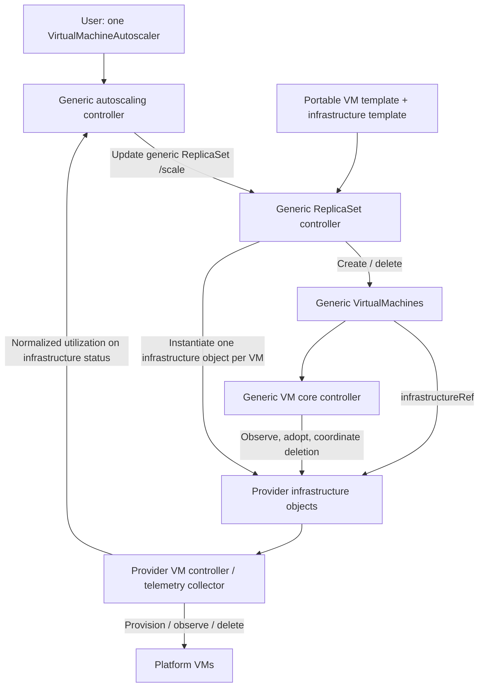

# Horizontal VM autoscaling at the KubeVM layer

**Status**: Draft proposal · **Date**: 2026-10-22 · **Epic**: TBD

Related artifacts: [behavioral spec](spec.md), [plan](plan.md), [tasks](tasks.md), [API model](model.md), [source evidence](research.md). This is a separate architectural proposal from [VM Service autoscaling](../012-vm-horizontal-autoscaling/spec.md); it does not silently replace that design.

## Recommendation and scope

Implement workload replication and autoscaling above the portable `kube-vm.io` VirtualMachine. One VirtualMachineAutoscaler resource specifies CPU and/or memory targets and bounds. One autoscaling controller calculates desired capacity and writes the generic ReplicaSet's `/scale` subresource. The generic ReplicaSet creates and deletes generic VMs; providers continue implementing individual platform VMs. Metrics are measurements, never externally supplied replica recommendations.

A Deployment is **not required for autoscaling**. A ReplicaSet supplies the template, membership, desired count, and replacement behavior that autoscaling needs. A Deployment adds coordinated template revisions, rolling replacement, surge/unavailability budgets, and rollback. Add it later when those behaviors are required. Then the autoscaler must target the Deployment's `/scale`, while the Deployment alone distributes replicas across its ReplicaSets. Do not autoscale its child ReplicaSets independently.

A generic ReplicaSet **is required for this proposed architecture**: the existing VM Operator ReplicaSet creates `vmoperator.vmware.com` VMs, not portable KubeVM VMs. Reusing it directly would place workload ownership below the abstraction and would not generalize to another provider. The KubeVM roadmap calls this resource `VirtualMachineSet`; this document uses `VirtualMachineReplicaSet` as a working name for the same responsibility. Resolve the name before API implementation; do not introduce both kinds.

Goals are portable replication, CPU/memory target scaling, safe asynchronous lifecycle handling, one replica-count authority, and independently evolvable providers. The first slice supports homogeneous, interchangeable, same-provider replicas in one namespace, with an explicit application-readiness contract. It must be testable with two provider implementations without importing either into generic core.

Non-goals are rolling updates, cross-provider placement or failover, heterogeneous capacity, stateful identity, vertical scaling, scale from zero, host scaling, predictive scaling, arbitrary application queries, and implementing customer-specific IPAM/load-balancer/draining integrations. These integrations remain prerequisites where the application requires them.

## What exists and what must be added

The inspected KubeVM checkout has generic VirtualMachine types, a core controller, and VM Operator linkage. `spec.infrastructureRef` is an immutable same-namespace `{apiGroup, kind, name}` reference to a provider object. Core resolves its served API version using the REST mapper. This reference identifies an object; it is not a metrics endpoint.

Core currently waits for an externally created provider object, checks the mutual name link, adds ownership, mirrors fixed status paths, and coordinates deletion. It does not create the provider object. Providers read portable intent from the generic VM and persist their resolved platform configuration. Core writes lifecycle metadata but does not manage provider-specific spec fields.

The current status contract includes power state, provider ID, addresses, metadata, InfrastructureReady and UpToDate. It has no CPU/memory contract. Generic Ready currently mirrors infrastructure readiness; it does not establish application readiness. Neither generic sets/templates nor autoscaling is implemented in the inspected module. Accordingly, infrastructure instantiation, utilization reporting, and application-readiness semantics are explicit additions, not existing capabilities implied by the reference.

## Proposed architecture

The metrics arrow is an input to the same controller reconciling the autoscaler. Its reader and bounded sample cache are internal implementation details. No additional autoscaling mode, recommendation resource, or separate scaling authority is introduced.

| Component | Owns | Must not own |
|---|---|---|
| Generic autoscaler | Metric interpretation, safety policy, target replica count | VM creation, provider queries, platform credentials |
| Generic ReplicaSet | Membership, portable/infrastructure pair instantiation, desired-count convergence | Utilization decisions or platform provisioning |
| Generic VM core | One-to-one infrastructure binding, status projection, deletion ordering | Platform-specific configuration resolution |
| Provider controller/collector | Platform provisioning, actual capacity, measurement normalization, cleanup | Generic replica counts |
| Future Deployment | Template revisions and counts of its child sets | Competing writes with an autoscaler to those child sets |

## Templates, instantiation, and ownership

Propose a generic set containing a portable VM template and an immutable, UID-bound infrastructure-template reference. The portable template omits the concrete `infrastructureRef`; the set supplies it per child. A provider template advertises a versioned instantiation contract exposing the target resource kind and a schema-validated `spec.template` payload. Provider admission validates provider-only fields, including references and tenant permissions. Resolved portable intent continues to come from the generic VM, not duplicate configuration baked into the infrastructure template.

Generic code may stamp an approved unstructured template, but must never infer provider-specific fields or clone an existing live VM object. This is a deliberate higher-level instantiation extension to today's read/status machine contract. Providers must implement the template contract to participate. An alternative provider-owned factory is possible, but requires a new asynchronous request protocol; opaque template instantiation is the proposed first implementation because ownership and retry behavior stay Kubernetes-native.

Creation proceeds as follows:

1. Allocate a unique member identity and deterministic infrastructure name from it. Create the generic VM, owned by the set, with that concrete infrastructureRef and immutable template revision identity. Never copy one concrete reference to every replica.
2. Read back the generic VM UID; create exactly one infrastructure object with a controller owner reference to that VM, the existing mutual-link annotation, and an additional UID binding defined by the new contract. Persist the selected template identity on the generic VM so restart can resume the same operation. Do not reuse a colliding existing object.
3. Core verifies mutual linkage, UID binding, and absence of another controller owner before adopting/observing. Provider admission and reconciliation must tolerate the brief interval where only the generic VM exists. Providers resolve portable fields and provision through their existing lifecycle.
4. Retry missing-half creation idempotently. Recheck deletion and identity immediately before creation; use owner references, provider rejection of deleted/mismatched parents, and orphan cleanup to handle a deletion racing the create. A lost create response must not produce another pair. Deleting a generic VM with no provider object must complete safely.

Only the generic VM is controller-owner of its infrastructure object. A provider VM must not simultaneously belong to a VM Operator ReplicaSet. The set never directly deletes the platform VM: it deletes the selected generic VM and lets core/provider finalizers complete platform cleanup. Terminating members continue to count toward outstanding work; blocked finalizers must not cause an unbounded replacement wave. Use bounded create/delete concurrency, API create expectations, UID preconditions, and retries with backoff.

Initial set membership is exclusively controller-owned children with matching labels and template revision, with no automatic orphan adoption. Freeze templates and selectors for a set revision; users create a new set to change the template until Deployment rollout support exists. No implicit replacement of all members on a template edit.

## Portable utilization contract

Propose an optional, versioned `status.utilization` block on each infrastructure object, published by its provider controller or collector. Core's autoscaling reader follows each member's infrastructureRef and verifies both VM and infrastructure UIDs before consuming it. Samples remain on provider objects rather than being copied into generic VM status, avoiding a second stream of status writes. Existing lifecycle providers remain valid without this optional capability; an autoscaler targeting one reports UnsupportedMetrics and holds capacity.

Each report contains contract version, bound generic VM UID, observed generic generation, infrastructure generation, observation timestamp, window start/end, metric semantic identifier, numerator, denominator, effective capacity, and validity/reason. Percentages are derived from those quantities; a changed capacity or binding invalidates the measurement window. Samples must distinguish unsupported, missing, initializing and invalid from a genuine zero. Reject negative, non-finite, out-of-range, future-dated, expired, mismatched-generation and mismatched-identity reports.

CPU means time-averaged consumed CPU divided by configured vCPU capacity over the same window, normalized to 0–100 percent for the whole VM. Providers must translate counters such as per-core percentages instead of passing raw counter values as though they were equivalent. Scheduler demand/ready time is not CPU usage.

Memory is a required design decision before memory implementation: active/working-set memory and guest OS used memory are different metrics. The earlier VM Service proposal suggests active guest physical memory/configured memory; that is not automatically a portable contract. Require one named semantic with demonstrably comparable implementations on supported providers, or declare the metric unsupported there. Never substitute host consumed memory or another provider's different definition. CPU can be implemented while this gate remains open; the CPU-and-memory feature is not complete until memory is qualified.

A provider collector batches backend requests, uses provider credentials only in its own process, and publishes no more often than the agreed cadence. It may share an existing provider metrics collector. Do not require Prometheus or a metrics-server pipeline for this first design. Status publication is a proposed transport with a scale qualification gate: if API-server write cost is unacceptable, revise the contract to a provider-owned batched read service before shipping; do not introduce a second user-facing autoscaling API.

## Scaling policy and readiness

For a converged set of N equal-capacity eligible VMs, compute each configured metric's mean utilization U and recommendation `ceil(N * U / target)`. Select the largest valid metric recommendation. For example, four VMs at 90% CPU with target 60% request six; memory requesting five does not override CPU. This is target utilization, not an unconditional add-one threshold trigger.

Proposed defaults retain the VM Service design: 30-second evaluation, 60-second complete sample window, maximum sample age 90 seconds, 10% tolerance, at most 25% scale-out (at least one VM) per 60 seconds, one scale-in per 300 seconds, and 300-second downscale stabilization. Bounds satisfy `1 <= minReplicas <= maxReplicas`. Automatic scale-in is disabled unless explicitly enabled. These are proposals for qualification, not measured platform guarantees.

A VM is eligible only when ownership, template capacity, identity, powered-on state, completed provisioning and explicit application readiness hold throughout the window. Add a versioned application-readiness observation with freshness and generation semantics; do not reinterpret today's generic Ready or provider InfrastructureReady. A provider may adapt the VM Operator readiness probe; another provider must supply equivalent declared evidence. A future workload integration can supply readiness, but cannot write replica counts.

Until desired count, actual non-terminating members, readiness, and provisioning/deletion operations converge, hold automatic scaling. Startup timeout reports a failure; it does not authorize repeatedly adding more VMs. A metric is usable only with complete coverage of the eligible membership window. A complete CPU metric can authorize scale-out when memory is unavailable; any missing configured metric blocks scale-in. No valid metric means no metric-driven write, including automatic correction to newly edited bounds until telemetry is valid. Manual repair requires explicitly suspending/releasing scaling authority.

Persist enough decision history to enforce rate limits and stabilization across leader changes, or conservatively wait a full protection window when history is unavailable. Use optimistic concurrency on `/scale`; conflicts require rereading current membership and recomputing. Enforce one autoscaler per UID-bound same-namespace target and reject competing count changes through both parent-resource updates and `/scale`. Suspension stops writes while retaining the claim; deleting the autoscaler releases it without changing capacity.

Scale-in is supported only where deletion cleanup and workload retirement are safe. Infrastructure readiness says nothing about draining. Workloads needing F5 deregistration, IPAM release, DNS cleanup, or domain removal remain blocked from automatic scale-in until a tested lifecycle implementation supplies those guarantees. Keep generic lifecycle hooks as a separate contract decision rather than silently inserting platform scripts into the autoscaler.

## Deployment, operation, and scale

Initially host generic set and autoscaler controllers in the existing manager embedding KubeVM core, gated independently and disabled by default. The inspected container-provider example already embeds core in its provider manager. This avoids requiring another Supervisor pod simply for autoscaling; it does not require generic packages to import provider code. Register generic workload controllers exactly once per cluster ownership scope. Multiple provider managers must not independently register cluster-wide set/autoscaler reconcilers under unrelated leader leases.

On Supervisor, VM Operator is the initial host. Its installer must deliver the generic CRDs, admission/RBAC changes, feature configuration and compatible provider metrics implementation before enabling reconciliation. Keep backend collection asynchronous, bounded and isolated from reconcile workers. Reuse the manager's existing leader election for the embedded controllers and make collection leader-aware. If multiple providers share one cluster, designate one generic-controller host (provider-independent manager is the future packaging option); providers only register their own provider reconcilers and collectors.

Embedding means no new pod request, but not zero resource cost. Budget an initial **unmeasured incremental** 250m CPU and 256 MiB memory for the leader as a benchmark starting point; measure total manager RSS/CPU and update requests/limits for every eligible leader replica. Do not impose a guessed limit that destabilizes the existing VM lifecycle manager. A separate deployment should be considered only after profiling shows isolation is needed or multi-provider ownership requires it; then size it from the same measurements and package it through the Supervisor component lifecycle, not an ad hoc manifest.

With V managed VMs, A autoscalers, and publication interval S, status publication is approximately `V / S` writes/second before retries; 10,000 VMs at 30 seconds means about 333 writes/second. This is a load illustration, not a supported limit. Indexed watches cache infrastructure status by UID and enqueue affected sets; evaluation uses cached measurements, with direct identity/generation checks before actuation. Dynamic watches must be allowlisted by supported provider GVK, reference-counted, and bounded. Avoid listing every VM or making a backend request per autoscaler reconcile.

Use bounded sample retention proportional to V and the window, bounded recommendation history per A, backend batch limits, jitter, queue concurrency limits, and rate limiting per provider. Expose queue latency, sample age/coverage, collection duration/errors, decision reasons, replica convergence time and throttling without high-cardinality per-VM metric labels. Qualification covers API/etcd pressure, slow backends, event storms, peak scale-out, failover, and coexistence with ordinary VM lifecycle reconciliation. Support limits and resource reservations remain release gates.

## Upgrades, disablement, and migration

Version the lifecycle, instantiation, readiness and telemetry capabilities separately. An old provider may continue individual VM lifecycle while being ineligible for autoscaling. An unsupported or malformed capability must stop scaling, not interrupt existing VMs. Preferred served API version discovery alone is not capability negotiation; add explicit version/capability discovery and conformance tests.

Install compatible CRDs/webhooks/providers first; upgrade generic controllers next; enable the feature last. During mixed-version rollout, only the elected owner writes counts. Retain CRDs, stored policies, sets, VMs, and finalizer handling on feature disablement. Disabling autoscaling freezes replica counts; disabling set creation must preserve deletion/cleanup processing and must not delete workload CRDs. Rollback is supported only to a version that understands stored fields and outstanding finalizers; otherwise freeze creation/scaling and complete migration before downgrade. Test conversion and defaulting as versions are introduced.

Keep spec 012 as the VM Service-specific delivery option. Reuse pure scaling-policy concepts/tests where practical, but keep the generic module independent of the root VM Operator module. Do not run both designs against the same population. Existing VM Operator sets cannot be converted by merely creating generic wrappers: they already own their platform VMs. Initial migration creates a separate generic set, validates application readiness, shifts traffic through the workload's normal procedure, then retires the old set. In-place ownership transfer is deferred until it has an explicit transactional migration design.

## Decisions required before implementation

- **Q1 — API/ownership**: Confirm VirtualMachineSet versus VirtualMachineReplicaSet naming, owning KubeVM repository, API version, template shape, UID linkage and instantiation capability. Proposed direction is one generic set and opaque provider templates.
- **Q2 — Metrics**: Settle portable memory semantics, provider implementations, freshness/clock skew policy, and status-write scale envelope. Proposed transport is infrastructure status.
- **Q3 — Readiness/deletion**: Define application-readiness evidence and supported retirement guarantees. InfrastructureReady is insufficient.
- **Q4 — Packaging/qualification**: Identify Supervisor installer owner, supported version matrix, singleton generic host, resource reservations and target load envelope.

These gates are explicit because the current KubeVM machine contract does not yet supply them. The architecture can be reviewed now; dependent implementation tasks remain blocked until their contracts are recorded.
