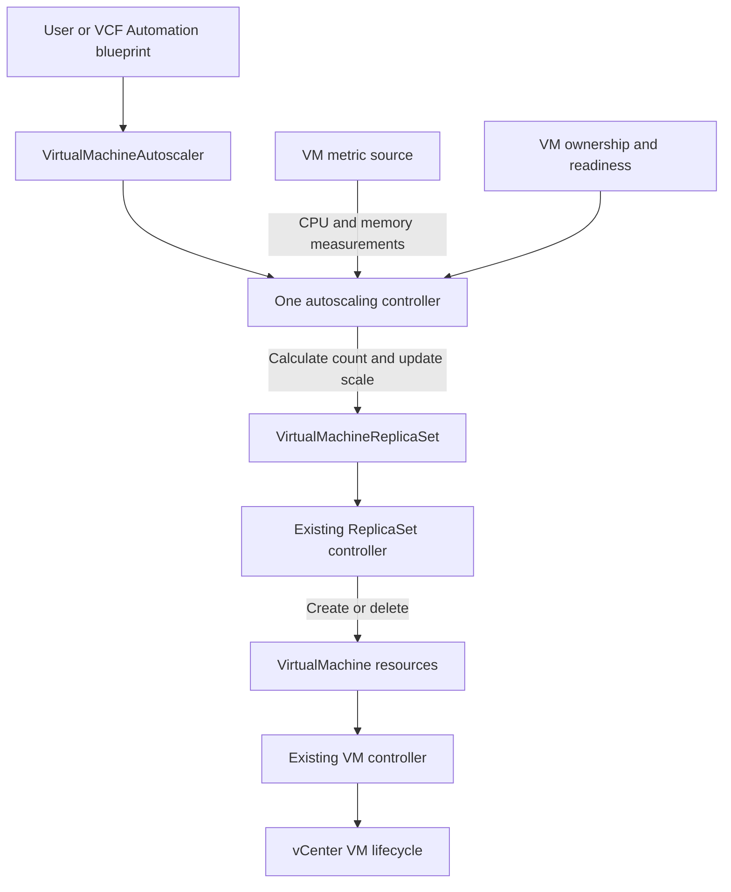

# VM Service Horizontal Autoscaling Design Draft

VM Service should provide one namespaced HPA resource, provisionally named `VirtualMachineAutoscaler`, defining the target VirtualMachineReplicaSet, CPU and/or memory metrics, utilization targets, replica bounds, and scaling behavior. One autoscaling controller reconciles this resource: it reads measurements, calculates the desired replica count, and updates the ReplicaSet through `/scale`. Existing ReplicaSet and VM controllers retain responsibility for creating, deleting, and managing individual VMs.

**Status: Draft for architecture discussion, 20 October 2026.** The design incorporates customer needs from the four supplied Confluence pages and the agreed single-resource, single-autoscaling-controller model. The field documents take precedence over the earlier Prometheus PoC as requirement context; their workflow implementations are not the product API. This is not the SDD spec. API naming/version, metric definitions, sizing, and defaults remain proposals.

# Goals and non goals

## Problem and intended users

A DevOps user running a horizontally scalable application on VM Service should be able to declare a VM template, minimum and maximum replica counts, and utilization targets, then have VM Service adjust capacity without manual replica edits. A tenant administrator must retain quota and authorization controls. A Supervisor administrator must be able to deploy, upgrade, troubleshoot, and disable the feature without disrupting existing VMs.

The HPA resource declares the metrics and targets; its controller owns scaling decisions. A CPU target of 60% means the controller attempts to maintain average VM CPU utilization near 60%, subject to tolerance, bounds, readiness, and stabilization. Metric sources supply measurements. VCF Automation blueprints and Day-2 actions can create or edit the HPA resource.

## Goals for the first release

- Automatically increase and decrease replicas of one existing VirtualMachineReplicaSet in the policy's namespace. New VMs use that ReplicaSet's template, including its image, class, storage, networking, and bootstrap configuration.

- Support CPU and memory percentages, separately or together, in the same HPA resource. The controller calculates a desired replica count for each configured metric and selects the largest result, subject to scaling safeguards.

- Keep desired replicas within user bounds during normal operation; explain capacity, quota, unavailable metrics, startup, and rate-limit constraints. Bounds describe desired capacity, not an instantaneous guarantee about running VMs.

- Account for VM provisioning and application startup. Never interpret missing telemetry, a powered-off VM, or a starting VM as zero utilization.

- Preserve existing capacity during telemetry outages and prevent repeated scale requests while a previous change is unresolved.

- Support All Apps/Day-2 integration, namespace isolation, one scaling authority per target, observable decisions, suspend/resume, and predictable behavior through process restarts and Supervisor upgrades.

- Bound control-plane, vCenter, and Kubernetes API load. Publish a measured support envelope and deployment resource profile before release.

## Non goals for the first release

- Vertical resizing, ESXi/cluster capacity autoscaling, scheduling changes, or new placement guarantees.

- Rollouts, image upgrades, template revision management, or updating existing replicas when a template changes.

- Scale from zero, scheduled or predictive scaling, custom application metrics, or arbitrary PromQL.

- Autoscaling standalone VMs, stateful sets, cross-namespace targets, or arbitrary Kubernetes scalable resources.

- Making an application horizontally scalable or redistributing application data. Product-specific F5, IPAM, DNS, and domain-join implementations remain with integration owners; their readiness and cleanup contracts are in scope for integration.

- A customer-operated Prometheus stack or guest exporter as a default prerequisite.

## Workload boundary

Initial support is for interchangeable Windows or Linux replicas whose work can redistribute as capacity changes. A VM readiness probe plus infrastructure checks establishes basic eligibility. Integrated workloads additionally require an authenticated lifecycle report that application validation and traffic admission completed; a VM heartbeat alone does not establish that it is serving traffic.

The field SDD sequences hostname/IP allocation, VM provisioning, application validation, tagging, and F5 pool admission, with VM/IPAM cleanup on failure. Preserve these outcomes. Automatic scale-in for external-load-balancer workloads remains disabled until a tested drain-before-delete and address-release contract is available. The supplied field sources describe scale-out; they do not establish a complete safe scale-in implementation. Field SDD (WIKI page 2590012453)

# Existing foundation

The repository baseline inspected is commit `d2e068ec0`.

| Existing surface | Design implication |
| --- | --- |
| `api/v1alpha6/virtualmachinereplicaset_types.go` defines template, desired replicas, observed replicas, and ready replicas | Reuse the ReplicaSet as the capacity actuator; keep policy separate |
| Generated ReplicaSet CRD exposes `/scale` with spec and status replica paths | Autoscaler can write only desired replica count through the established interface |
| Scale configuration has no `labelSelectorPath` | Standard Kubernetes HPA is not a drop-in consumer today |
| ReplicaSet controller adopts matching orphan VMs without conforming their configuration | Count only confirmed target-owned VMs; validate actual capacity before using a homogeneous-replica algorithm |
| Current readiness helper treats a VM with no probe as implicitly ready | `readyReplicas` alone is insufficient for autoscaling eligibility |
| Existing deletion policy is named `Random`; implementation orders equal-priority VMs by name | Autoscaler must not promise deletion of the least busy VM |
| ReplicaSet registration depends on `K8sWorkloadMgmtAPI` | Autoscaling capability must depend on workload-management availability |
| Supervisor overlay exists at `config/wcp/vmoperator/` in `vmware-system-vmop` | Extend the product deployment pipeline rather than requiring tenant installation |

The associated ReplicaSet TDS and test plan are under `.sdd/specs/009-virtualmachinereplicaset/`. Some historical gap descriptions differ from current code; the readiness behavior above comes from the current implementation. Resolve those differences during the subsequent specification work.

# Field requirements and design mapping

| Source evidence | Architectural consequence |
| --- | --- |
| Field SDD uses VCF Operations and Day-2 workflows to detect load and change capacity | Implement that customer outcome in the HPA controller; metric-source selection is an implementation decision |
| Field SDD checks maximum count, cooldown, and outstanding operations | Enforce these in every reconciliation |
| Field SDD includes hostname/IP allocation, application validation, and F5 admission | Preserve lifecycle integration requirements; power-on is not application readiness |
| All Apps PoC includes Windows/Linux templates, secrets, and network/load-balancer configuration | Blueprints create the existing ReplicaSet/template plus an HPA resource |
| All Apps PoC adds one VM with a maximum of ten | Evidence for bounded growth; its example step and cap do not define the product API |
| Workload one-pager excludes autoscaling from ReplicaSet responsibility | Introduce a separate HPA resource/controller |
| Earlier Prometheus PoC demonstrates CPU-based proportional scaling | Algorithm context only; no mandatory monitoring stack |

The field SDD (WIKI page 2590012453) and All Apps PoC (WIKI page 2733417273) provide higher-priority customer requirements. Their workflow-based implementation is replaced by the HPA reconciliation loop. All Apps and Day-2 actions configure the HPA; the operator owns ongoing metric evaluation and replica changes.

The sources do not settle memory semantics or a complete scale-in protocol. They also differ in tagging time between initial deployment and scale-out. Use stable workload identity for inventory and readiness/in-service evidence for sample eligibility so booting VMs cannot dilute utilization before serving traffic.

# Architecture and alternatives

## Proposed architecture

Introduce one namespaced **VirtualMachineAutoscaler** resource and one autoscaling controller. The controller reads metric samples through an internal provider interface, evaluates the policy declared in the resource, and updates the target ReplicaSet’s `/scale`. The resource name and served API version remain proposals.



Keep policy evaluation in `pkg/`, orchestration in `controllers/`, and all vSphere calls behind provider interfaces in `pkg/providers/vsphere/`. A manager runnable performs batched collection. The new binary registers only the autoscaling controller and its collector; it must not accidentally register the existing VM or ReplicaSet controllers. Admission and conversion remain with the existing VM Operator webhook service.

The collector and autoscaling controller run in the same proposed Supervisor-managed deployment, only on the elected leader. The collector is an internal service of the operator, not another policy controller or API. Standby pods provide availability for the same operator. Deployment isolation protects normal VM reconciliation from telemetry resource usage.

## Alternatives considered

| Option | Benefit | Limitation and disposition |
| --- | --- | --- |
| VM HPA resource with a VM-aware controller | One API for metric policy and one replica-count decision maker | Proposed choice; VM Operator owns scaling safety and tests |
| Standard Kubernetes HPA with a VM metric adapter | Reuses upstream policy machinery | Alternative implementation requiring selector plumbing and VM lifecycle handling |
| Run the VM HPA controller in the existing manager | Fewer pods and shared caches | Same API/model, but telemetry failures share the core VM lifecycle process |
| Field custom ReplicaSet or AutomatedVirtualMachineGroup | Existing customer integrations | Preserve requirements while reusing native ReplicaSet; migration needed |
| Earlier Prometheus pipeline | Demonstrates proportional VM scaling | Context only; no mandatory Pushgateway or Prometheus dependency |

Kubernetes HPA can target scalable custom resources, but its CPU/memory Resource metrics path is pod-oriented. VM integration would need Object/External metrics and an adapter, rather than treating VMs as pods. HPA also offers target-ratio scaling, multiple-metric maximum selection, and stabilization. [Kubernetes HPA documentation](https://kubernetes.io/docs/concepts/workloads/autoscaling/horizontal-pod-autoscale/)

CRD scale selector configuration uses a serialized label-selector string. Upstream HPA currently rejects an empty scale selector before evaluating metrics, including Object/External metrics. Adding a selector alone does not provide VM readiness semantics. Validate the exact behavior against the Kubernetes version shipped on the intended Supervisor release. [CRD scale documentation](https://kubernetes.io/docs/tasks/extend-kubernetes/custom-resources/custom-resource-definitions/#scale-subresource), [upstream HPA controller](https://github.com/kubernetes/kubernetes/blob/master/pkg/controller/podautoscaler/horizontal.go)

# Policy API and ownership

The API should express intent without exposing vCenter counter IDs or query syntax.

| Proposed field | Contract |
| --- | --- |
| Target reference | Same-namespace ReplicaSet name and immutable UID binding |
| Replica bounds | `minReplicas >= 1`; `maxReplicas >= minReplicas` |
| Metrics | CPU and/or memory with target percentages and documented measurement semantics |
| Scaling behavior | Tolerance, stabilization, startup allowance, and scale-up/down rates |
| Scale-in permission | Enabled only with an accepted deletion contract |
| Suspend | Stop initiating changes and preserve desired count |

The ReplicaSet owns the VM template. The HPA references it without duplicating image, class, network, or bootstrap configuration. The metric provider is an internal implementation detail.

Illustrative spec shape; field names and the API version will be finalized in the SDD:

```yaml
spec:
  scaleTargetRef:
    kind: VirtualMachineReplicaSet
    name: web-tier
  minReplicas: 2
  maxReplicas: 20
  metrics:
    - name: cpu
      targetPercentage: 60
    - name: memory
      targetPercentage: 70
```

For a concrete example, a policy for a web-tier ReplicaSet could request 2–20 replicas, a CPU target of 60%, a memory target of 70%, and automatic scale-in for a stateless application. These percentages mean the metric definitions in the next section.

Require the policy name to equal its target ReplicaSet name and make the target immutable. Kubernetes object-name uniqueness then prevents two policies of this kind targeting the same ReplicaSet, without a racy list-and-check admission rule. This intentionally trades arbitrary policy names for simple exclusivity.

While an HPA is active, its controller is the sole supported writer of the target replica count. Automation clients configure the HPA; they do not submit replica-count recommendations or patch replicas. Extend admission for replica changes through the main resource and `/scale` to reject competing writers. Users suspend the HPA before manual scaling. Activation/suspension races require authoritative checks and resource-version guards. Reject targets whose parent also writes replicas unless that parent participates in an explicit ownership handoff.

Policy creation and updates must require authority to scale the named target, not merely permission to create the policy. Use namespace RBAC plus an admission authorization check. Reject cross-namespace references. Read target objects, VM ownership, and provider identities from trusted API state; never accept raw tenant-provided vCenter object IDs.

Expose observed generation, target UID, current/desired/eligible/pending replica counts, measured values and timestamps, calculated and limited desired counts, last successful scale, and conditions such as Ready, MetricsAvailable, ScalingActive, and ScalingLimited. Conditions report facts; the controller evaluates current objects and measurements rather than using its previous conditions as execution gates. Distinguish VM-created, application-ready, and in-service counts where integrations require it.

# Metric semantics and collection

## CPU and memory definitions

**CPU usage percentage:** use the vSphere VM `cpu.usage.average` counter for aggregate VM utilization across its vCPUs. This is the host view of actively used virtual CPU relative to available virtual CPU capacity. Percent counter values are fixed-point values; normalize once in the provider. Do not divide MHz by VM CPU reservation or use host-wide utilization. [vSphere CPU counters](https://developer.broadcom.com/xapis/vsphere-web-services-api/latest/cpu_counters.html)

**Proposed memory usage percentage:** estimated active guest physical memory divided by configured VM memory, multiplied by 100, using the VM `mem.usage.average` semantics or verified equivalent active-memory samples and matching capacity. vSphere estimates active memory from touched pages. This is not guest OS used-memory percentage or host consumed memory. Display it as **active memory utilization** in API documentation and UI. [vSphere memory counters](https://developer.broadcom.com/xapis/vsphere-web-services-api/latest/memory_counters.html)

The field pages do not specify the memory counter or denominator. Active-memory utilization remains a proposal. If VCF Operations is selected as a metric source, its metric key, units, aggregation, window, and denominator must satisfy the same measurement contract. The HPA controller still evaluates the configured thresholds and computes replicas. Guest OS available/used memory would require a supported telemetry source and documented prerequisites.

Memory scaling also assumes workload redistribution reduces per-replica demand. Replicated caches, fixed heaps, and leaks may not respond to added replicas. Max bounds limit growth, but cannot make those workloads suitable for memory-driven scaling.

## Collection contract

Collect only VMs belonging to ReplicaSets targeted by HPA resources. Index namespace and VM UID to target UID and validated provider identity; labels alone are insufficient. Propose direct vSphere performance collection initially. VCF Operations can be evaluated as an alternative implementation of the internal metric interface, supplying samples to the same reconciliation algorithm. Metric-source selection does not create another autoscaling API or scaling authority.

Resolve counter IDs by metadata rather than hard-coding numbers. Discover supported sampling intervals, counter availability, and privileges for supported vCenter/ESXi releases. Query multiple VMs and both metrics in bounded batches with concurrency limits, timeouts, retry backoff, jitter, and a global vCenter budget. Treat unsupported counters, disabled accounting, stale timestamps, invalid values, and identity changes as unavailable data.

A normalized sample carries VM UID, metric semantic version, source timestamp, interval, value, and relevant capacity identity. Reject samples crossing power-cycle or resize transitions and rebuild the window after such changes. Use a short bounded memory cache; do not persist raw time series in VM status or etcd.

Provisional engineering settings are a 30-second collection/evaluation cadence, a 60-second time-weighted measurement window, and maximum newest-sample age of 90 seconds. These are design inputs for testing, not validated service guarantees. Require adequate interval coverage as well as a fresh last sample.

# Scaling decisions and safety

## Reconciliation algorithm

The controller applies this algorithm to every HPA resource. Favor a conservative converged-set algorithm initially; it trades burst responsiveness for understandable behavior with slow VM startup.

1. Read the current policy and target, verify the UID binding, capability, authorization, and absence of deletion or suspension. Recheck authoritative state before applying a decision.

2. Obtain the target-owned membership and ensure it agrees with the ReplicaSet selector/counting contract. Exclude terminating VMs from utilization, but treat their presence as a pending transition.

3. Require desired count to match the actual non-terminating owned count, with no pending creates or deletes. Require every member to be powered on, provisioned, and application-ready for the complete measurement window. A VM that fails startup blocks further metric-based changes and produces an actionable reason. Where a lifecycle integration is configured, require its current-UID in-service evidence as well as VM readiness.

4. Require homogeneous actual CPU/memory capacity compatible with the template. Adopted or resized members that violate this condition block scaling until corrected; capacity-weighted heterogeneous scaling is future work.

5. For each metric with complete valid coverage, calculate `ceil(N × measuredAverage / targetPercentage)`, where N is the converged eligible count. Inside a proposed relative tolerance of 10%, retain N. Choose the largest recommendation across metrics.

6. Scale-in requires complete valid coverage for every configured metric. Scale-out may use one complete metric even if the other metric is unavailable. Partial coverage within a metric invalidates that metric; missing samples are never zero.

7. Apply stabilization, direction-specific rate limits, and replica bounds. Persist the recommendation/status as needed, then update only `/scale` using a resource-version precondition. On conflict, reread and recompute; never blindly retry the old count.

8. Once a count is changed, wait for convergence and a new complete ready measurement window before another metric-based change.

Example: four converged VMs average 90% CPU against a 60% target, yielding six replicas. Memory at 35% against a 70% target yields two. The controller selects six as the calculated count. With the proposed 25% scale-up limit, it first requests five, waits for readiness, then reevaluates fresh measurements. It does not repeatedly multiply stale utilization by an increasing desired count.

The ratio and multi-metric approach follow established HPA principles; the convergence barrier, ownership contract, and full VM sample requirements are proposed VM-specific behavior.

## Stabilization and exceptional paths

Propose a five-minute scale-in stabilization window and no scale-out stabilization beyond the measurement window. Choose the highest valid recommendation in the scale-in window. Begin testing with a maximum increase of the greater of one VM or 25% of current replicas per 60 seconds, and a maximum decrease of one VM per 300 seconds. Startup timeout should be configurable; an initial ten-minute default is a test hypothesis.

Changing bounds is explicit user intent. Raising the minimum can request capacity without utilization samples, subject to rate limits and unresolved-operation limits. Lowering the maximum must surface that it can remove VMs; apply deletion safety and rate limits rather than immediately deleting the difference. Under suspension or incomplete lifecycle information, report that current desired capacity is outside the new range and hold. If an active target is manually driven to zero outside the supported ownership flow, report the violation and require recovery; CPU/memory policies do not infer demand at zero.

Persist last-scale timestamps and bounded operation metadata, not every sample. A crash may occur after a successful scale write but before status persistence: on every leadership change rebuild membership and telemetry, assume unknown recent scaling, and wait a full rate-limit period before new changes and a full scale-in stabilization window before deletion. Resume upward decisions after fresh complete data and the conservative cooldown. This covers lost history without a distributed transaction between policy and target.

Insufficient quota, placement failure, image download delay, storage/network exhaustion, or a stuck finalizer must not trigger unlimited desired-count increases. Hold while unresolved, expose the bottleneck, and let existing controllers handle VM lifecycle retries.

## Application lifecycle integration

Application integrations handle identity, bootstrap, readiness, and traffic membership. They provide lifecycle evidence to the HPA controller and never calculate or write the desired replica count.

For integrated scale-out, allocate per-replica identity/address and bootstrap inputs before the VM needs them, then provision, validate the application, register the pool member disabled, wait for health, and enable traffic. The lifecycle owner reports in-service for that exact VM UID; only then is the operation complete. This follows the field SDD (WIKI page 2590012453). The native ReplicaSet currently stamps VM templates and does not provide the field AVM controller's pre-provision IPAM workflow. A pre-provision integration API or a supported existing VM network/bootstrap mechanism is therefore a prerequisite, not an assumed capability. Never let an AVM controller and native ReplicaSet independently create the same replica.

On application validation or pool-registration failure, the integration owns compensating actions: remove any pool entry, coordinate VM cleanup, and release address/hostname allocations only when safe. Coordinate replacement with the ReplicaSet, which otherwise recreates a missing desired replica; bound failed-replica retries so compensation cannot become an infinite create/delete loop. Retain an operation failure that users can inspect.

Before external-LB scale-in is enabled, the lifecycle integration must identify the actual deletion candidate, stop new traffic, drain existing work, permit VM deletion, and release identity/address allocations after cleanup. A VM finalizer alone is insufficient if traffic withdrawal and drain ordering are undefined. Candidate coordination with the ReplicaSet and deletion timeout behavior are explicit prerequisites; until implemented, that integration supports scale-out only.

# Supervisor deployment and lifecycle

## Packaging and installation

Ship the autoscaler binary in a product-managed image built and versioned with VM Operator. Extend the Supervisor VM Service installation and upgrade manifests to create the deployment, service account, RBAC, configuration, leader-election Lease, probes, metrics endpoint, and certificate/credential references. The repository's WCP Kustomize overlay is a concrete manifest integration point; the owning external Supervisor packaging component and installer sequencing must be confirmed with its maintainers.

Use a proposed two-replica Deployment in `vmware-system-vmop`, one leader and one standby, spread across Supervisor control-plane nodes where supported. Use the supported system scheduling priority and tolerations, a disruption budget retaining one replica, and a rolling update allowing one surge pod. A standby improves availability but does not double collection throughput.

The feature is installed by the Supervisor product lifecycle. No per-namespace or per-VM autoscaler pod, new metrics API server, Prometheus deployment, or persistent volume is required. The proposed vSphere metric source does not require VCF Operations. Application lifecycle integrations have separately owned resource and availability requirements.

## Availability and resources

Use startup/readiness probes for cache initialization and controller health, and liveness for process health. A vCenter outage should produce degraded scaling status rather than endless liveness restarts. Both replicas can be process-ready while only one leads; expose leadership separately.

Proposed initial **benchmark configuration per pod**: request 250m CPU and 256 MiB memory; limit 1 CPU and 1 GiB memory. This is not a measured production sizing recommendation. Two replicas reserve 500m/512 MiB; an upgrade with one surge reserves 750m/768 MiB. Account for cache warming and up to three pod limits during upgrade when sizing Supervisor capacity.

Use restricted container privileges, read-only root filesystem where supported, bounded temporary storage, and graceful shutdown. Establish a least-privilege performance-reading vCenter session through supported VM Operator credential machinery; verify exact privileges and rotation behavior. Limit network access to required platform endpoints. Automation clients configuring the HPA use scoped Kubernetes credentials and verified TLS. The field PoC labels its super-admin installation path as a workaround; product packaging uses supported platform mechanisms.

## Enablement, disablement, and deletion

A new autoscaling capability defaults off and requires `K8sWorkloadMgmtAPI`. Use `pkgcfg.FromContext(ctx)` to gate registration, collection, and writes. Install admission routes and schemas coherently; disabled functionality must not leave webhook paths pointing to missing handlers.

Suspension or capability disablement stops initiating scale updates and preserves the last ReplicaSet desired count. Already accepted creation/deletion operations may finish. Support reading, suspending, and deleting existing HPA resources while disabled.

Deleting an HPA stops autoscaling without deleting the target or restoring an old count. Deleting a ReplicaSet invalidates the binding; the HPA cannot recreate it or attach to a replacement with the same name. Avoid an HPA finalizer unless an external resource requires cleanup. Pool membership and address allocations remain owned by their application lifecycle integration; deleting the HPA does not remove them from running VMs.

# Scale implications and operational limits

Let V be monitored VMs, A HPA resources, M configured metrics, T collection seconds, and B VMs per query batch. A collection cycle returns approximately V × M values per sampling point; request rate is approximately ceil(V/B) / T if both metrics share a query. Actual cost depends on returned intervals and provider query limits. Include metric discovery lag and lifecycle callbacks in end-to-end latency measurements.

An illustrative workload of 10,000 VMs, two metrics, a 30-second cadence, and 100 VMs per batch implies about 3.3 batch requests per second and 667 values per second for one sample per metric. Window queries can return several times that volume. **These are arithmetic examples, not supported scale claims.**

Keep sample storage O(V × M × retainedSamples), policy history O(A × boundedWindow), and membership indexing O(V). Include informer/object-cache and standby memory in measurements; raw numeric sample size alone is not a sizing model. Use field indexes and trimmed cached objects where feasible rather than repeated full-namespace scans.

Bound concurrent evaluations, vCenter batches, API writes, event emission, and simultaneous scale operations. Apply per-namespace fairness so one tenant cannot monopolize the queue. Write status on meaningful changes with a throttled heartbeat, not every VM sample. Global overload makes data stale and holds unsafe decisions; it must not cause unbounded queues or broad retry storms.

Extra pods behind one leader do not increase throughput. If the measured support envelope requires sharding, introduce explicit exclusive target ownership and shared vCenter budgets as a separate design extension.

Before release, qualify VM/policy/namespace count, churn, simultaneous scale-outs, vCenter latency, source sampling limits, cache RSS, garbage collection, decision latency, and effect on existing VM lifecycle. Bound total response time as metric window + queue/evaluation delay + provisioning + application readiness. Autoscaling cannot guarantee immediate capacity or provision resources the cluster lacks.

# Upgrade and compatibility

1. Install compatible CRDs and webhook handlers before controllers can enable new behavior. Keep the feature off until the Supervisor advertises the complete capability.

2. Update autoscaler and VM Operator components with a tested version-skew matrix. New controllers must tolerate the previously supported schema and target versions for the supported rolling-upgrade window.

3. Preserve leader-election identity through rollout. The replacement leader uses the same cold-start safety rules as a failure restart.

4. Treat metric semantics and default behavior as API contracts. Do not change the memory denominator, target interpretation, or rate semantics silently during an upgrade.

5. For schema evolution, follow repository compatibility rules, including versioning and conversion when required; do not assume additive fields on a shipped API are safe. Regenerate deepcopy and CRD manifests.

6. Rollback disables scaling before downgrading to a version that cannot interpret existing policies. Preserve CRDs and policy data; leave ReplicaSets at their last desired count and provide manual control after suspension. Do not uninstall a CRD as a rollback shortcut.

7. Test credential/certificate rotation and vCenter upgrades as lifecycle events. Invalidate stale samples, rediscover capabilities where needed, and resume only after validation.

PoC migration requires a resource-model handoff as well as a scaling-policy handoff. The All Apps PoC uses `automation.pscoe.vmware.com` ReplicaSets, while the field SDD uses AutomatedVirtualMachineGroup/AutomatedVirtualMachine; neither is the native `vmoperator.vmware.com` ReplicaSet. Inventory children, ownership, allocations, bootstrap secrets, pool membership, and monitoring-group bindings. Suspend the old writer, preserve desired capacity, validate a native target and integration mapping, and activate the new policy only after ownership is unambiguous. Do not copy custom blueprint fields into a native template or change owner references automatically. If safe in-place transfer is unavailable, use a staged replacement deployment with traffic cutover. Preserve Windows/Linux bootstrap and secret references through the supported template/integration APIs.

# Observability and validation

A user should be able to explain a decision from policy status and events: which metric drove it, which VM count and window were used, why the recommendation was capped, and why scaling is blocked. Emit scale events on actual changes and rate-limit repeated errors. Report collector latency/errors, sample freshness/coverage, queue depth, reconcile latency, scale outcomes, provisioning wait, leader transitions, and throttling. Keep exported metric label cardinality bounded; detailed per-VM diagnostics belong in scoped troubleshooting output.

The SDD should turn these into observable acceptance criteria:

- CPU-only, memory-only, and combined-metric load cause bounded creation from the template and safe removal of replicas.

- Boot spikes, partial telemetry, unsupported counters, power transitions, and provider outages do not cause unsafe scale-in.

- Slow or failed provisioning and quota exhaustion do not produce runaway desired counts.

- Ownership checks prevent cross-namespace control, duplicate HPAs for a target, stale target UID reuse, and competing replica writers.

- Suspension, policy deletion, capability disablement, leader failover, rollout, and rollback preserve the documented replica-count contract.

- Metric units and semantic definitions match vCenter measurements on supported platform versions.

- Real Supervisor E2E tests cover metric-driven decisions, All Apps creation/update of the HPA, Windows/Linux bootstrap, in-service reporting, partial F5/IPAM failure, safe teardown, and leader failure during a scale write.

Use unit tests with controlled clocks for the algorithm, envtest for CRDs/admission/concurrency, provider tests for normalization and batching, and real vCenter/Supervisor tests for counters and lifecycle. Simulated performance APIs cannot establish metric accuracy or production scale. No implementation or test execution is part of this architecture draft.

# Decisions before the SDD

| Decision | Proposed position | Required confirmation |
| --- | --- | --- |
| API/control ownership | One HPA resource declares metrics/policy; one controller computes replicas | Agreed direction; finalize API name/version |
| Metric source | Internal measurement interface; direct vSphere collection proposed initially | Compare accuracy, availability, cadence, cost, and permissions with VCF Operations |
| Memory percentage | Active/configured memory proposed | Confirm intended counter and denominator |
| Replica lifecycle | Preserve identity allocation, bootstrap, validation, and traffic admission | Pre-provision and in-service evidence contracts |
| Scale-in | Eligible workloads only; external-LB workloads require draining | Candidate selection, timeout, cleanup, and failure behavior |
| Migration | Reuse native ReplicaSet and retire workflow replica writes | Supported ownership and workload migration path |
| Capacity/defaults | Provisional cadence, rates, and pod resources | Measurements and dependency discovery lag |
| Packaging | One autoscaling controller; separate deployment proposed for isolation | Placement, version skew, capability, and resource contracts |

The implementation handoff is now drafted in [SDD 012](../../.sdd/specs/012-vm-horizontal-autoscaling/spec.md), with a [plan](../../.sdd/specs/012-vm-horizontal-autoscaling/plan.md), [tasks](../../.sdd/specs/012-vm-horizontal-autoscaling/tasks.md), [API model](../../.sdd/specs/012-vm-horizontal-autoscaling/model.md), and [research](../../.sdd/specs/012-vm-horizontal-autoscaling/research.md). Epic remains TBD by author instruction. The SDD makes the initial API and conservative defaults concrete and marks unresolved decisions as task gates; no implementation has started. The final architecture wiki destination remains WIKI page 644900152; this repository document is the review draft.

# Source references

**Confluence sources reviewed through MCP**

- VM Service Workload Management of VMs using Kubernetes Patterns One Pager (WIKI page 1007649487) — existing workload-management context.

- Metric Based Horizontal Autoscaling of AppVMs using Prometheus (WIKI page 885824695) — historical PoC context only.

- Horizontal Autoscaling SDD (WIKI page 2590012453) — higher-priority field input.

- All Apps VM Autoscaler PoC (WIKI page 2733417273) — higher-priority customer/field input.

**Repository evidence**

`api/v1alpha6/virtualmachinereplicaset_types.go`; `config/crd/bases/vmoperator.vmware.com_virtualmachinereplicasets.yaml`; `controllers/virtualmachinereplicaset/virtualmachinereplicaset_controller.go`; `controllers/virtualmachinereplicaset/virtualmachinereplicaset_delete_policy.go`; `controllers/controllers.go`; `config/wcp/vmoperator/kustomization.yaml`; `.sdd/specs/009-virtualmachinereplicaset/`; and repository rules indexed by `.sdd/INDEX.md`. Public API and Kubernetes references are linked beside the claims they support.

